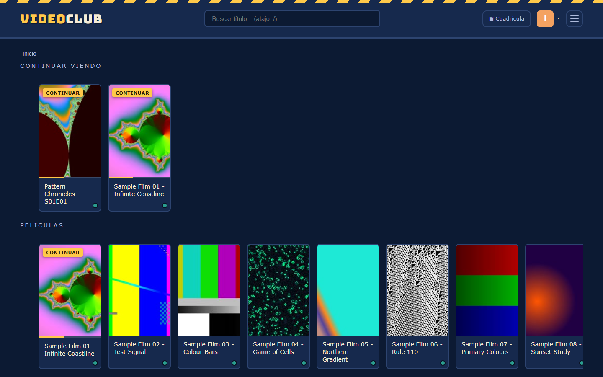

# Videoclub Local

Web local, accesible solo desde la red doméstica, para ver los vídeos de una carpeta concreta con una interfaz al estilo de un videoclub.



> ⚠️ **Este proyecto nunca debe exponerse a internet.** Ver [SECURITY.md](SECURITY.md) - es un criterio de diseño permanente, no una limitación temporal a resolver.

> El backlog de trabajo son los [issues de GitHub](https://github.com/Jesus-md-dev/videoclub-local/issues), replicados localmente en `Proyectos/issues-index/videoclub-local/`.

## Requisitos

- Node.js 18 o superior.
- No necesitas instalar `ffmpeg` aparte: se usa `ffmpeg-static`, que trae su propio binario para generar las carátulas.

## Instalación

```bash
npm install
```

Esto también instala las dependencias del frontend en `client/` (vía `postinstall`).

## Configuración

La carpeta de vídeos se puede fijar de dos formas:

- **Desde la web** (recomendado): entra en `/config` (página sin enlace visible desde el catálogo) y usa el campo de texto o el botón "Examinar..." para elegirla. Se guarda en `data/settings.json` y no requiere reiniciar el servidor.
- **Por variable de entorno** (solo se usa si no hay nada guardado en `/config`): copia `.env.example` a `.env` y ajusta:

```bash
cp .env.example .env
```

| Variable | Descripción | Ejemplo |
|---|---|---|
| `VIDEOS_PATH` | Ruta absoluta a la carpeta con los vídeos a servir | `C:\Users\tu_usuario\Videos` |
| `PORT` | Puerto en el que escucha el servidor | `3000` |

## Arranque

El frontend (React) hay que compilarlo antes de arrancar el servidor:

```bash
npm run build
npm start
```

Al arrancar, la consola muestra las URLs de acceso, tanto local como desde la red:

```
Videoclub local escuchando en el puerto 3000
  Local:    http://localhost:3000
  Red:      http://192.168.1.X:3000
```

Desde cualquier otro dispositivo conectado a la misma red Wi-Fi/LAN, abre la URL de "Red" en el navegador.

## Funcionalidad

- Frontend en React (Vite), servido como estático desde Express (`client/dist`).
- Escaneo recursivo de la carpeta de vídeos configurada, al arrancar y cada vez que se cambia desde `/config`.
- Catálogo en cuadrícula con carátulas generadas automáticamente a partir de un fotograma del vídeo.
- Buscador para filtrar el catálogo por título.
- Reproductor con soporte de salto en la barra de progreso (streaming por rangos de bytes).
- "Continuar viendo": recuerda el punto de reproducción de cada vídeo (guardado en el navegador).
- Página de configuración oculta (`/config`) con explorador de carpetas para elegir la carpeta de vídeos sin escribir la ruta a mano.
- Navegación por carpetas (secciones "Series"/"Películas"), con carátula de carpeta = primer vídeo dentro.
- Categorías/géneros automáticos por título (TVmaze, Jikan/MyAnimeList y Wikidata; sin API key) con filtro por género en el catálogo. Cachea los resultados en `data/metadata.json`; si un título no se encuentra, simplemente no muestra género, sin errores.
- Selector de pista de audio y subtítulos (extraídos a WebVTT bajo demanda) en el reproductor.
- Conversión automática bajo demanda a H.264/MP4 para vídeos con códecs no compatibles con navegadores móviles (p.ej. HEVC en `.mkv`).
- `POST /api/scan` para volver a escanear la carpeta sin reiniciar el servidor.
- Copia de seguridad automática: perfiles, progreso ("Continuar viendo"/visto), carpeta configurada, caché de géneros y analítica se guardan también en `<carpeta de vídeos>/.videoclub-datos/`. Al arrancar en un PC nuevo (o tras reinstalar), si `data/` está vacío se recupera automáticamente de ahí, sin perder el historial al cambiar de máquina.

## App para la tele (Android TV, Google TV, Fire TV)

`android-tv/` es una APK propia (WebView a pantalla completa, no un navegador) para manejar el videoclub con el mando, como Netflix: sale en la pantalla de inicio de la tele, la cruceta mueve el foco por toda la web, OK abre, Atrás vuelve (dos veces en el catálogo para salir), mantener OK (o Menú/Info) abre la ficha de la carátula, y los botones de play/pausa, avanzar y retroceder van al reproductor. En un móvil la misma APK funciona como siempre (táctil).

**Instalarla:** en la tele, instala la app *Downloader* (en Fire TV está en la tienda; en Android TV/Google TV, cualquier gestor de archivos que descargue por URL) y abre `http://192.168.1.200:3000/videoclub-tv.apk`. Hay que permitir "instalar apps desconocidas" para esa app la primera vez. Se instala encima de la APK anterior (mismo paquete y firma). Si el PC cambia de IP, la app enseña una pantalla para corregir la dirección.

**Probar el modo tele en el PC:** abre la web con `?tv=1` (se recuerda en ese navegador; `?tv=0` lo quita) y usa las flechas, Intro y Escape.

**Recompilarla** (tras cambiar `android-tv/`; los cambios de la web no lo necesitan): hace falta `android-tv/keystore.properties` (no se sube; ruta y contraseña del keystore de `Proyectos/videoclub-apk/`, ver su `LEEME-IMPORTANTE.txt`):

```
storeFile=C:/Users/jesus/Documents/Proyectos/videoclub-apk/android.keystore
storePassword=...
keyAlias=android
keyPassword=...
```

```bat
set JAVA_HOME=C:\Users\jesus\.bubblewrap\jdk\jdk-17.0.11+9
set ANDROID_HOME=C:\Users\jesus\.bubblewrap\android_sdk
cd android-tv && gradlew.bat assembleRelease
copy app\build\outputs\apk\release\app-release.apk ..\client\public\videoclub-tv.apk
```

Sube `versionCode` en `android-tv/app/build.gradle` en cada versión nueva. Hay un emulador de Android TV 11 en `E:\AndroidEmu` (AVD `tv30`) para probarla.

## Cuidado al liberar espacio en disco

- `data/hls` **NO siempre es caché desechable**. Cuando un vídeo ya era compatible con el navegador, su HLS es un simple remux (mismo vídeo, sin recodificar) y el original se borra automáticamente para no duplicarlo (ver `archivedVideos.js`). Para esos vídeos, `data/hls/<id>/` es la **única copia que queda** — borrarla los pierde para siempre, sin forma de regenerarlos. Antes de tocar `data/hls` a mano, comprobar `data/hls-archived.json`: cualquier id que aparezca ahí no se debe borrar de `data/hls` sin haber puesto el vídeo a buen recaudo antes.
- Si un vídeo archivado se queda sin original y sin copia HLS (p.ej. porque ya se borró `data/hls` a mano sin saber esto), el servidor lo detecta solo, deja de intentar regenerarlo, y lo apunta automáticamente en `<disco de la carpeta de vídeos>\Volver a descargar\episodios-perdidos.txt` (agrupado por serie, con su carpeta original) para saber qué hay que volver a conseguir. Esa lista se mantiene sola (`server/lostVideos.js`): no hace falta editarla a mano.

## Desarrollo

Para trabajar en el frontend con recarga en caliente:

```bash
npm start            # backend en el puerto 3000
cd client && npm run dev   # frontend en modo desarrollo (proxy a /api hacia el puerto 3000)
```

## Aviso de seguridad

Esta aplicación **no tiene autenticación** ni está pensada para exponerse a Internet. Solo debe usarse dentro de una red local de confianza (tu propia red doméstica).
